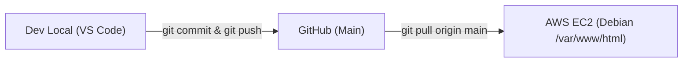

# 🍝 Markitos D'Oro — Trattoria Contemporânea & Alta Gastronomia

> Plataforma web de alta fidelidade visual e imersão sensorial desenvolvida para o restaurante e bistrô **Markitos D'Oro**, unindo a herança familiar siciliana iniciada em **1936** com a estética e a velocidade da alta gastronomia moderna.

---

## 📖 1. Conceito da Marca & O Significado "D'Oro"

O conceito do **Markitos D'Oro** equilibra a alma rústica da trattoria mediterrânea tradicional com a elegância minimalista de um bistrô intimista contemporâneo:
* **Origem Familiar (1936):** Fundado nas colinas ensolaradas da Sicília pelo avô do Chef Eduardo. A premissa histórica e inegociável da família é: *ingredientes nobres não necessitam de artifícios*.
* **A Aplicação do Conceito "D'Oro":** O ouro aqui não representa ostentação vazia. Representa a **nobreza e pureza da matéria-prima**:
  * A gema dourada de ovos orgânicos na massa aberta à mão;
  * O azeite extravirgem siciliano de primeira prensagem a frio;
  * O respeito sagrado ao tempo de cocção e descanso dos alimentos;
  * O valor inestimável de receitas familiares transmitidas por três gerações.
* **Prato Assinatura D'Oro:** **Tagliolini al Tartufo** — Massa fresca artesanal preparada na manhã de cada serviço, emulsão sedosa de manteiga pura de montanha alpina e lâminas generosas de trufas negras frescas colhidas em Norcia, finalizadas à mesa com flor de sal e azeite trufado. Harmonização sugerida: *Barolo DOCG* ou *Brunello di Montalcino*.

---

## 👨‍🍳 2. Persona do Negócio: Chef Eduardo

* **Idade:** 40 anos.
* **Experiência:** 10 anos dedicados à liderança culinária e comando de cozinhas de alta gastronomia.
* **Filosofia de Vida:** Combina a disciplina das técnicas contemporâneas internacionais com a memória afetiva das cozinhas de aldeia sicilianas. Entre o calor da lenha e o frescor das ervas colhidas no dia, Eduardo escolhe pessoalmente cada produto e desenha pratos concebidos para despertar memórias e encantar os sentidos.
* **Citação do Chef:**
  > *"O verdadeiro ouro de um prato não reside na extravagância visual, mas na pureza do ingrediente, no respeito ao tempo e no afeto impresso em cada detalhe que chega à sua mesa."*

---

## ⚡ 3. Stack Tecnológica Futurista & Performance 95+

Para evitar sites pesados e lentos criados com plugins construtores inchados (como Elementor ou Divi), o tema foi construído de raiz com uma arquitetura moderna e ultrarrápida:

* **Core:** WordPress 6.x / 7.x nativo (PHP 8.4 no Debian EC2)
* **Design System & Estilização:** [Tailwind CSS](https://tailwindcss.com/) com paleta personalizada (*Nero Vulcano, Ouro Champanhe, Creme Siciliano, Salvia*)
* **Motor de Animações Cinemáticas:**
  * **[Lenis](https://github.com/darkroomengineering/lenis):** Smooth scroll contínuo e responsivo de alto padrão.
  * **[GSAP 3 + ScrollTrigger](https://greensock.com/gsap/):** Revelação gradual com stagger, efeito parallax nas fotos e timeline de entrada.
  * **Cursor Magnético Dourado:** Microinteração interativa com anel expansivo sobre botões, pratos e links.
* **Abas Interativas de Cardápio:** Filtro instantâneo sem recarregamento de página por categorias (*Antipasti, Primi Piatti, Secondi, Dolci, Vinhos & Cocktails*).
* **Gestão Dinâmica no Painel:** Custom Post Type nativo (`prato_doro`) com suporte a taxonomias, thumbnails e Gutenberg.

---

## 📂 4. Estrutura do Repositório (Tema WordPress)

```text
gastronomia-site-wordpress/
├── README.md                      # Documentação técnica oficial e completa
├── style.css                      # Folha de estilos e declaração obrigatória do tema
├── functions.php                  # Enfileiramento de scripts, fontes, CPTs e helpers
├── header.php                     # Topbar com blur glassmorphism, status e navegação
├── footer.php                     # Rodapé nobre, horários, endereço, cursor e copyright
├── front-page.php                 # Template da página inicial do WordPress
├── index.php                      # Template mestre e fallback universal
├── Gemini_Generated_Image_...jfif # Fotografia oficial em alta resolução do Chef Eduardo
├── assets/
│   ├── css/
│   │   └── custom.css             # Efeitos de brilho, glow, crachás e scrollbar
│   ├── js/
│   │   ├── main.js                # Interatividade de abas e reservas no WhatsApp
│   │   └── animations.js          # Orquestração do GSAP, ScrollTrigger e Lenis
│   └── images/                    # Imagens otimizadas dos pratos e identidade
└── template-parts/
    ├── section-hero.php           # Primeira impressão: tela cheia e tipografia de impacto
    ├── section-historia.php       # O Legado Siciliano de 1936 e memorial da família
    ├── section-chef.php           # Biografia, foto e manifesto do Chef Eduardo
    ├── section-menu.php           # Cardápio sensorial e destaque do Tagliolini al Tartufo
    ├── section-experiencia.php    # A atmosfera intimista, luz de velas e adega
    └── section-reservas.php       # Formulário VIP integrado diretamente com WhatsApp
```

---

## ☁️ 5. Guia Completo na AWS EC2 (Debian 11 ou 12)

### A. Regras de Entrada no Security Group (Firewall da AWS)
No console da AWS > **EC2 > Security Groups > Inbound Rules**, garanta as regras:
* **Porta 22 (SSH):** Acesso ao terminal.
* **Porta 80 (HTTP):** Acesso web ao WordPress.
* **Porta 443 (HTTPS):** Acesso seguro com certificado SSL.

---

### B. Associar o Endereço IP Elástico (Elastic IP)
Para evitar que o IP mude ao reiniciar a máquina:
1. No console da AWS > **EC2 > Elastic IPs**.
2. Selecione o IP alocado (`54.225.139.150`).
3. Clique em **Ações > Associar endereço IP elástico**.
4. Selecione a sua instância do Debian e confirme a associação.

---

### C. Atualizar o IP Elástico no Banco de Dados MariaDB
Caso o WordPress tenha sido configurado com o IP provisório anterior, execute no terminal da EC2:

```bash
sudo mariadb -u wpuser -p -e "USE wordpress; UPDATE wp_options SET option_value='http://54.225.139.150' WHERE option_name IN ('siteurl', 'home');"
```

---

### D. Ajustar os Limites de Upload do PHP no Servidor
Para permitir fotografias pesadas em alta resolução:

```bash
sudo sed -i 's/upload_max_filesize = 2M/upload_max_filesize = 32M/' /etc/php/*/apache2/php.ini
sudo sed -i 's/post_max_size = 8M/post_max_size = 32M/' /etc/php/*/apache2/php.ini
sudo systemctl restart apache2
```

---

### E. Configurar Permissões Seguras no Linux
No terminal da EC2, certifique-se de que o Apache (`www-data`) possui propriedade e permissões:

```bash
sudo chown -R www-data:www-data /var/www/html
sudo find /var/www/html/ -type d -exec chmod 755 {} \;
sudo find /var/www/html/ -type f -exec chmod 644 {} \;
```

---

### F. Ativar SSL Gratuito com Let's Encrypt (Quando apontar domínio)
Assim que tiver um domínio registrado (ex: `markitosdoro.com.br`):

```bash
sudo apt install certbot python3-certbot-apache -y
sudo certbot --apache -d markitosdoro.com.br -d www.markitosdoro.com.br
```

---

## 🛠️ 6. O que Fazer no Painel do WordPress (/wp-admin)

Acesse: `http://54.225.139.150/wp-admin` com seu usuário administrador.

1. **Ativar o Tema Markitos D'Oro:**
   * Vá em **Aparência > Temas**.
   * O tema **Markitos D'Oro** aparecerá na lista.
   * Clique em **Ativar**.

2. **Configurar Links Permanentes (Permalinks Amigáveis):**
   * Vá em **Configurações > Links Permanentes** (Permalinks).
   * Selecione **Nome do post** (`/%postname%/`).
   * Clique em **Salvar alterações**.

3. **Definir Página Inicial Estática:**
   * Vá em **Páginas > Adicionar Nova**.
   * Crie uma página com o título **Início** (ou Home) e clique em **Publicar**.
   * Vá em **Configurações > Leitura**.
   * Marque **Uma página estática** e escolha **Início** como a página principal.

4. **Limpeza de Conteúdos Padrão:**
   * Em **Posts**, exclua o post de exemplo *"Olá, mundo!"*.
   * Em **Páginas**, exclua a *"Página de Exemplo"*.

---

## 🔄 7. Ciclo de Versionamento de Código (Git Workflow)

O código-fonte do tema é versionado exclusivamente por este repositório do GitHub. Nunca é necessário editar código diretamente na AWS.

### Fluxo de Trabalho:


### A. Para Trabalhar Localmente no Windows
Se o Windows bloquear a criação de arquivos locais devido à propriedade do Administrator, abra o PowerShell como Administrador e execute uma única vez:

```powershell
icacls "D:\gastronomia-site-wordpress" /grant "Users:(OI)(CI)F" /T
```

Depois, para atualizar seu ambiente local com as novidades do repositório:
```bash
cd D:\gastronomia-site-wordpress
git pull origin main
```

### B. Para Atualizar a Produção na AWS EC2
Basta conectar via SSH à sua instância EC2 e rodar:

```bash
cd /var/www/html/wp-content/themes/markitos-doro
sudo git pull origin main
sudo chown -R www-data:www-data /var/www/html/wp-content/themes/markitos-doro
```

Pronto! Todas as atualizações entram no ar instantaneamente.
